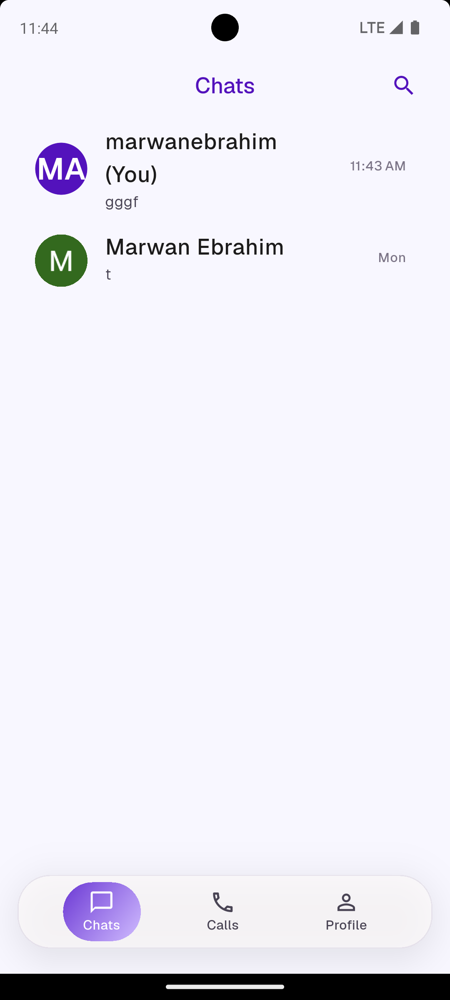
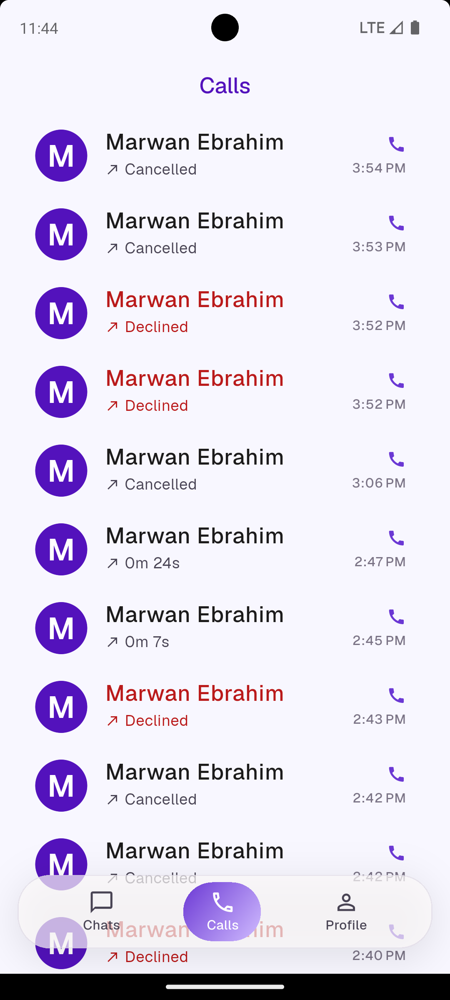
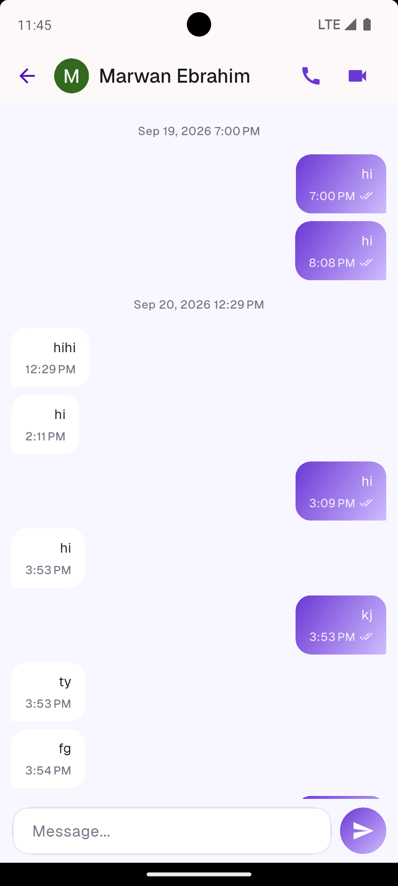
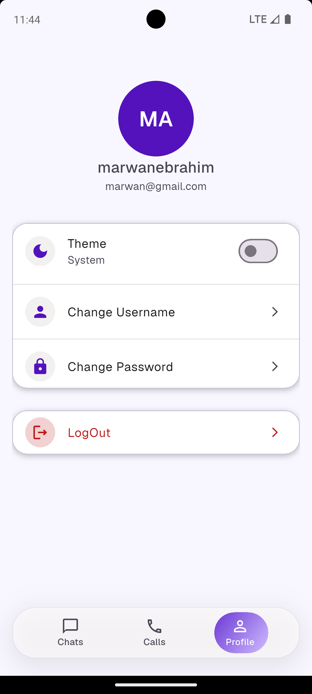
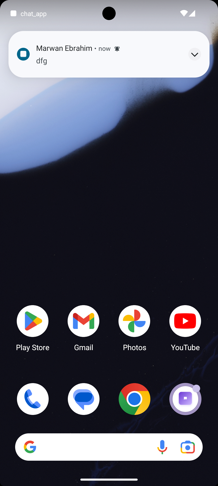

# <App Name>

A real-time 1-on-1 chat app built with Flutter, with voice/video calls, call history and push notifications.

## Demo

[▶ Watch the demo video](https://drive.google.com/file/d/1hZ_SRWRuT53FRsrOPVnE5zgbODku-efL/view?usp=drive_link)

[⬇ Download the APK](https://github.com/Marwanebrahim/chat_app/releases/tag/releases)

<!-- Add 4–6 screenshots: login, chats list, conversation, search, calls, profile (dark mode) -->

## Screenshots

<p>
  
  
  
  
  
  
</p>

## Features

- **Auth:** email/password and Google sign-in, change username/password, logout
- **Real-time chat:** messages over Firebase Realtime Database, optimistic sending (pending → sent → seen), failed messages with tap-to-retry, date separators
- **Conversations:** live list with last message, time and unread badge
- **User search:** case-insensitive username prefix search with debounce; you can also message yourself
- **Voice & video calls:** ZegoCloud call invitations, including when the app is in the background or closed (Android)
- **Call history:** completed, missed, declined, busy and cancelled calls with duration
- **Notifications:** push for new messages when the app is closed (Zego ZIMKit offline push over FCM), local notification when it is in the background, nothing while it is open
- **UX:** light/dark theme (persisted), skeleton loading, error and retry states

## Tech stack

Flutter · flutter_bloc / hydrated_bloc · Firebase Auth, Cloud Firestore, Realtime Database, FCM · Hive · ZegoCloud (call kit, signaling, ZIMKit) · flutter_local_notifications · Skeletonizer

## Architecture

```
lib/
├── bloc/        # one BLoC/Cubit per feature (events/states with Equatable)
├── core/        # constants, routes, themes, helpers, extensions
├── features/    # screens and widgets grouped by feature
├── models/      # UserModel, ConversationModel, MassegeModel, CallsModel
├── services/    # singleton services (auth, chat, search, calls, zego, notifications)
└── widgets/     # shared widgets
```

Design decisions:

- **Optimistic UI:** `ChatBloc` merges confirmed messages from the RTDB stream with locally pending ones by message id, so a sent message appears instantly and is replaced once the server confirms it.
- **Streams in BLoC:** blocs that listen to streams keep their event handler alive with a `Completer` and cancel the subscription on unsubscribe/close.
- **Deterministic conversation id:** the two user ids sorted and joined, so the same pair always resolves to the same conversation.
- **Per-user summaries:** each user has their own conversation summary (own unread count), written together in one Firestore batch.
- **Call history:** the caller writes the record for both users in one batch, so it is saved even if the receiver's app is closed.

## Data model

- Realtime Database: `chats/{conversationId}/messages/{messageId}`
- Firestore: `users/{uid}`, `users/{uid}/conversations/{conversationId}`, `users/{uid}/calls/{callId}`

## Getting started

1. Install Flutter and clone the repo, then run `flutter pub get`.
2. **Firebase:** create a project, run `flutterfire configure`, enable Email and Google sign-in, Firestore and Realtime Database, then publish the rules below.
3. **ZEGOCLOUD:** create a project and note the AppID and AppSign. In the console, under _Service Management → In-app Chat → Notification configuration_:
   - add your Firebase service account as the Android credentials
   - add a push resource `chat_app_call` (FCM channel `chat_app_call_channel`, FCM data messages enabled)
   - add a push resource `chat_app_message` (FCM channel `chat_app_message_channel`, FCM data messages disabled)
4. Create `env.json` in the project root (it is git-ignored):

```json
{
  "ZEGO_APP_ID": "your-app-id",
  "ZEGO_APP_SIGN": "your-app-sign"
}
```

5. Run on a real device (calls and push notifications do not work on emulators):

```bash
   flutter run --dart-define-from-file=env.json
```

## Firebase rules

Firestore:

```
rules_version = '2';
service cloud.firestore {
  match /databases/{database}/documents {
    match /users/{userId} {
      allow read: if request.auth != null;
      allow write: if request.auth != null && request.auth.uid == userId;

      match /conversations/{conversationId} {
        allow read: if request.auth != null && request.auth.uid == userId;
        allow write: if request.auth != null
                     && request.auth.uid in request.resource.data.participants;
      }

      match /calls/{callId} {
        allow read, write: if request.auth != null && request.auth.uid == userId;
        allow create: if request.auth != null
                      && request.auth.uid == request.resource.data.peerId
                      && request.resource.data.isOutgoing == false;
      }
    }
  }
}
```

Realtime Database:

```json
{
  "rules": {
    "chats": {
      "$conversationId": {
        ".read": "auth != null && $conversationId.contains(auth.uid)",
        ".write": "auth != null && $conversationId.contains(auth.uid)"
      }
    }
  }
}
```

## Notes

- Tested on Android only.
- The message text is also sent through ZIM so ZEGOCLOUD can deliver the offline push.

## Roadmap

- Online / last-seen presence
- Open the right conversation from a notification tap
- iOS support
